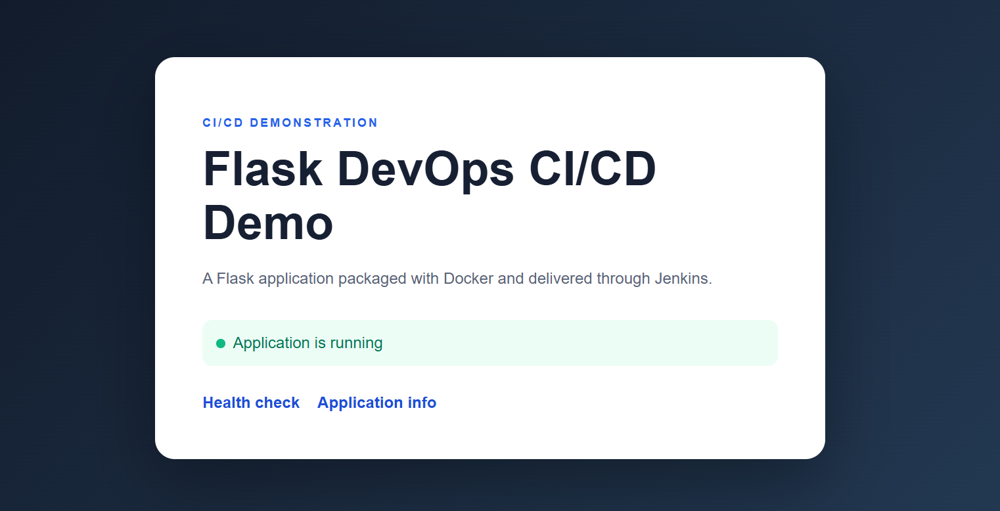
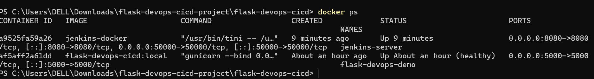
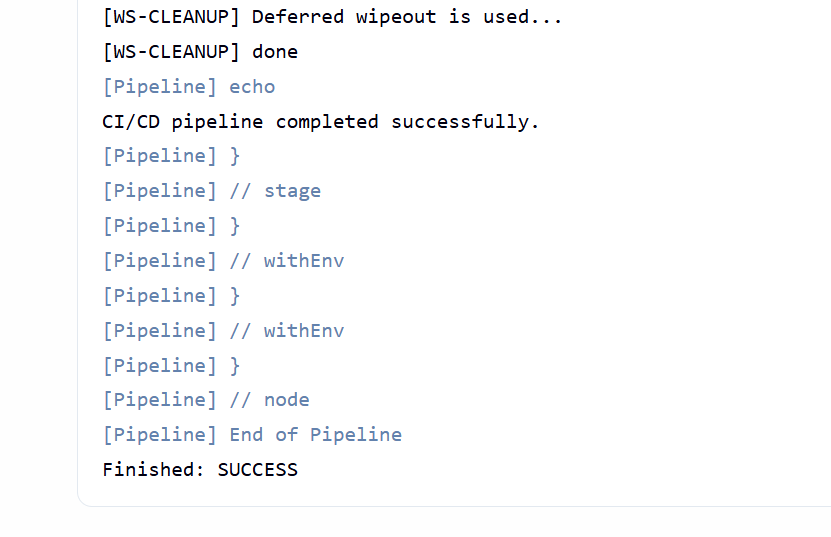

# Automated CI/CD Pipeline for a Containerized Flask Application

A hands-on DevOps portfolio project demonstrating automated Continuous Integration and Continuous Deployment (CI/CD) using **Jenkins, Docker, Git, GitHub, Python Flask, and Pytest**.

The project automates code checkout, testing, Docker image creation, and container health verification through a Jenkins Declarative Pipeline.

## Project Overview

The goal of this project is to automate the build and validation process of a Flask web application using Jenkins and Docker.

Whenever the pipeline is triggered, Jenkins:
1. Checks out source code from GitHub.
2. Creates a Python virtual environment.
3. Installs project dependencies.
4. Executes automated tests using Pytest.
5. Builds a Docker image.
6. Starts a temporary application container.
7. Verifies the application's health endpoint.
8. Cleans up the temporary container.

## Technologies Used

| Technology | Purpose |
|---|---|
| Python | Application development |
| Flask | Web application framework |
| Git | Version control |
| GitHub | Source code repository |
| Jenkins | CI/CD automation |
| Docker | Application containerization |
| Docker Compose | Local deployment |
| Pytest | Automated testing |
| Gunicorn | Production WSGI server |

## Architecture

```text
       Developer
           |
           v
      Git / GitHub
           |
           v
        Jenkins
           |
           v
    Source Checkout
           |
           v
    Python Environment
           |
           v
     Pytest Testing
           |
           v
    Docker Image Build
           |
           v
   Container Smoke Test
           |
           v
    Health Verification
           |
           v
      Build Success
```

## Project Structure

```text
flask-devops-cicd/
│
├── app/
│   ├── __init__.py
│   ├── templates/
│   │   └── index.html
│   └── static/
│       └── style.css
│
├── tests/
│   └── test_app.py
│
├── screenshots/
│   ├── flask-homepage.png
│   ├── docker-containers.png
│   └── jenkins-build-success.png
│
├── Dockerfile
├── Dockerfile.jenkins
├── Jenkinsfile
├── compose.yaml
├── requirements.txt
├── run.py
├── .gitignore
└── README.md
```

## Application Screenshots

### Flask Application



### Docker Containers



### Jenkins Successful Build



## Run the Application Locally

Clone the repository:

```bash
git clone https://github.com/yarraguntlakusumanjali/flask-devops-cicd-pipeline.git

cd flask-devops-cicd-pipeline
```

Create a virtual environment:

```bash
python -m venv .venv
```

Activate it on Windows:

```powershell
.venv\Scripts\activate
```

Install dependencies:

```bash
pip install -r requirements.txt
```

Run automated tests:

```bash
pytest -q
```

Start the Flask application:

```bash
python run.py
```

Open the application:

- Homepage: http://localhost:5000
- Health endpoint: http://localhost:5000/health
- Application information: http://localhost:5000/api/info

## Run Using Docker Compose

Build and start the application:

```bash
docker compose up --build -d
```

Check running containers:

```bash
docker compose ps
```

Stop the application:

```bash
docker compose down
```

## Jenkins CI/CD Configuration

### Jenkins Environment

The project uses a custom Jenkins Docker image containing:
- Jenkins LTS
- Docker CLI
- Python 3
- Python virtual environment support

Build the custom Jenkins image:

```bash
docker build -f Dockerfile.jenkins -t jenkins-docker .
```

Start Jenkins:

```bash
docker run -d --name jenkins-server \
  -p 8080:8080 \
  -p 50000:50000 \
  -v jenkins_home:/var/jenkins_home \
  -v /var/run/docker.sock:/var/run/docker.sock \
  jenkins-docker
```

For Windows PowerShell with Docker Desktop, use the corresponding Docker socket mount syntax:

```powershell
-v //var/run/docker.sock:/var/run/docker.sock
```

Open Jenkins at:

http://localhost:8080

### Create the Jenkins Pipeline

1. Open Jenkins Dashboard.
2. Select **New Item**.
3. Enter the job name: `Flask-DevOps-CI-CD`.
4. Select **Pipeline**.
5. Choose **Pipeline script from SCM**.
6. Select Git as the SCM.
7. Enter the GitHub repository URL.
8. Set the branch to `*/main`.
9. Set Script Path to `Jenkinsfile`.
10. Save and select **Build Now**.

### Pipeline Stages

| Stage | Description |
|---|---|
| Checkout | Retrieves source code from GitHub |
| Install and Test | Installs dependencies and executes Pytest |
| Build Docker Image | Creates and tags the application image |
| Container Smoke Test | Runs the application and checks its health endpoint |
| Post Actions | Removes the temporary test container and cleans the workspace |

## Key Features

- Automated CI/CD using Jenkins Declarative Pipeline.
- GitHub source code integration.
- Automated Python testing with Pytest.
- Docker-based application containerization.
- Docker Compose configuration.
- Container health verification.
- Gunicorn-based application serving.
- Non-root application container execution.

## Scope and Limitations

- Docker images are built locally.
- Images are not pushed to Docker Hub.
- No cloud deployment or Kubernetes orchestration is included.
- Jenkins requires Docker daemon access and a Linux-based execution environment for the pipeline shell commands.

## Future Enhancements

- Push Docker images to Docker Hub.
- Add SonarQube for code quality analysis.
- Integrate vulnerability scanning.
- Deploy the application to a cloud platform.
- Implement Kubernetes-based deployment.
- Add monitoring and logging.

## Interview Explanation

"I developed a Python Flask application and implemented an automated CI/CD pipeline using Jenkins and Docker. I integrated GitHub for source code management and configured Jenkins to automatically check out the code, create a Python virtual environment, execute Pytest test cases, build a Docker image, and perform container smoke testing. The application is containerized using Docker and supports repeatable local deployment through Docker Compose."

## Resume Description

**Automated CI/CD Pipeline for a Containerized Flask Application Using Jenkins and Docker**

- Developed a Python Flask web application with health-check and application-information REST endpoints.
- Implemented a Jenkins Declarative CI/CD pipeline integrated with GitHub for automated source checkout and testing.
- Automated Python dependency installation and test execution using Pytest.
- Built and managed Docker images and validated container health through automated smoke testing.
- Configured Docker Compose for repeatable local application deployment.

## Author

**Yarraguntla Kusumanjali**

GitHub: https://github.com/yarraguntlakusumanjali

Project Repository: https://github.com/yarraguntlakusumanjali/flask-devops-cicd-pipeline
